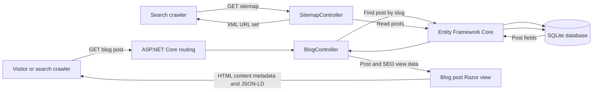
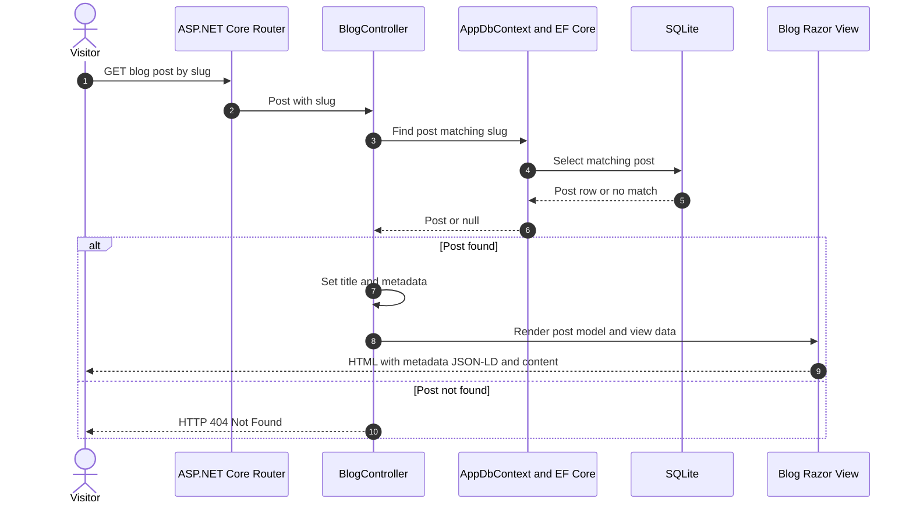

# Why Develop an SEO Application in .NET?

A practical ASP.NET Core MVC sample demonstrating how a .NET application can serve SEO-aware blog content. It uses Entity Framework Core with SQLite to retrieve posts by readable URL slugs and render page metadata, BlogPosting structured data, and an XML sitemap.

> **Project status:** This is a learning/demo application, not a production-ready publishing platform. Review the SEO and deployment notes below before using it with a real website.


## Why build an SEO-friendly application with .NET?

Search visibility depends on useful content, crawlable pages, sound technical implementation, and ongoing measurement—not on a framework alone. ASP.NET Core provides routing, server-rendered Razor views, and integrations such as Entity Framework Core that can help developers build these foundations.

This project illustrates a small set of those techniques:

- **Readable post URLs:** blog pages are routed as `/blog/{slug}`.
- **Server-rendered content:** post details are loaded and rendered in a Razor view.
- **Per-post metadata:** the post title and description are supplied to the page; the view also renders a keywords meta tag.
- **Structured data example:** the post view emits `BlogPosting` JSON-LD.
- **XML sitemap endpoint:** `/sitemap.xml` builds a sitemap from stored posts.
- **SQLite persistence:** Entity Framework Core maps the `Post` entity to the local database.

## Benefits

- **A clear technical SEO starting point:** see how routes, rendered HTML, metadata, structured data, and sitemap output fit together.
- **A familiar Microsoft stack:** build and extend the sample with ASP.NET Core MVC and Entity Framework Core.
- **A small, approachable codebase:** follow a request from the controller through data access to the Razor view.
- **Flexible learning and prototyping:** adapt the post model and persistence setup to experiment with content and SEO implementations.

These are implementation and learning benefits, not a guarantee of higher rankings. Search engines determine rankings using many factors outside this application.

## Use cases

- Learning server-rendered SEO fundamentals in ASP.NET Core.
- Prototyping a small blog with slug-based post pages.
- Demonstrating database-backed metadata and JSON-LD in a .NET project.
- Using as a foundation for a more complete content platform after adding production features such as authoring, validation, canonical URLs, and deployment configuration.

## Architecture and data flow

The application seeds one sample post on startup when the `Posts` table is empty. A request to a blog slug is handled by `BlogController`, which queries `AppDbContext` and passes the post and SEO values to the Razor view. The sitemap endpoint independently reads the posts and returns XML.



## Blog post request sequence



## Technology

- **Framework:** ASP.NET Core MVC on .NET 9
- **Language:** C# with Razor views
- **Data access:** Entity Framework Core 9
- **Database:** SQLite by default (`crawler.db`)
- **Other packages:** SQL Server EF Core provider is included for possible provider experiments; SQLite is the configured provider.

## Getting started

Prerequisites: .NET 9 SDK.

```bash
git clone https://github.com/hasanmonsur/Why-Develop-SEO-Application.git
cd Why-Develop-SEO-Application
dotnet restore
dotnet run
```

Open the local URL printed by `dotnet run`. The application uses the `DefaultConnection` setting in `appsettings.json` (`Data Source=crawler.db`). Startup code inserts a sample post when the database has no posts. The sample post slug is `sample-post`; visit `/blog/sample-post` and `/sitemap.xml` on the running host.

## Important production considerations

- **Set the real public domain in the sitemap.** `SitemapController` currently hard-codes `https://yourdomain.com` in every `<loc>`. Replace this placeholder with a configurable canonical site origin before publishing the sitemap; otherwise crawlers will receive incorrect URLs.
- **Use a canonical origin and HTTPS consistently.** Configure the production host, redirects, and canonical URL strategy for the deployed site.
- **Treat structured data as a template.** The current JSON-LD has a placeholder author (`Your Author Name`). Populate it with accurate content, serialize values safely, and validate the generated markup before production.
- **Do not rely on the keywords meta tag for ranking.** Prioritize useful, original content, descriptive titles and descriptions, accessible pages, and correct indexability. Metadata alone does not guarantee visibility.
- **Plan database migrations and content management.** The sample seeds one post but does not include an authoring interface, slug uniqueness validation, or a full publishing workflow.
- **Verify sitemap coverage and freshness.** The endpoint currently lists stored posts and uses their publication dates as `lastmod`; ensure this matches your actual content lifecycle.

## Search visibility and repository discoverability

This README uses descriptive project language and explains the real features to help developers and searchers understand the repository. To improve the application's search performance, publish helpful, original content; keep pages fast, accessible, mobile-friendly, and crawlable; use accurate page titles and descriptions; validate structured data and sitemap URLs; and monitor indexing and search performance with the relevant search-engine tools.

No README, keyword, or code change can guarantee that this repository or an application will rank in the top 10. Rankings depend on the search query, competition, authority, content quality, technical health, and search-engine systems. The changes here improve clarity and discoverability without promising a position.

## Further reading

- [Why Develop SEO Application in .NET? Benefits & How It Works](https://medium.com/asp-dotnet/why-develop-seo-application-in-net-benefits-how-it-works-5d894dce3af5)
